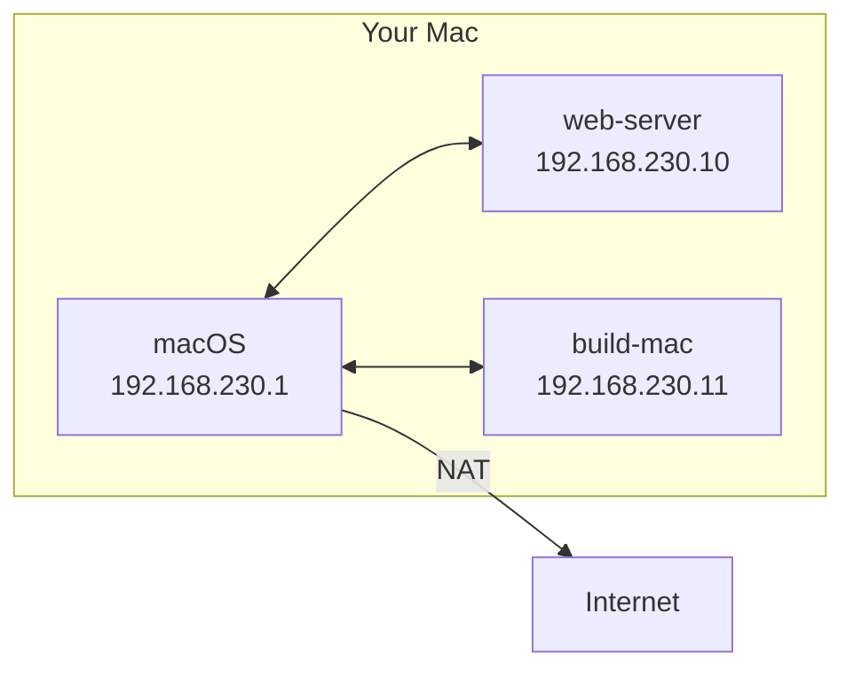

# Networking

By default, machines use a shared network that SwiftVM manages. Guests reach the
internet through your Mac, and your Mac and the guests reach each other
directly.



## Shared network addresses

- Each machine has a reserved address that normally stays the same between
  starts. If SwiftVM moves to another address range to avoid a conflict, the
  machines get new addresses.
- SwiftVM picks an address range that doesn't collide with the networks your
  Mac is on. **Settings → Network** shows it.
- A machine created while others are running gets a temporary address. It
  takes its own once every machine has been stopped and one is started again.

Find a machine's address in the panel, with **Copy IP Address** in its menu,
or with `swiftvm ip <machine>`.

## Bridged networking

Bridged networking connects a guest directly to your LAN through a host
interface, such as Ethernet. Your router assigns the guest its own address,
and other LAN devices can reach it directly. This supports local discovery
and multicast traffic for guests such as Home Assistant, subject to your
network's filtering rules. Ethernet is recommended for this use.

Shut down the machine, open its **Settings → Network**, and choose
**Bridged: Ethernet** (or another available interface) in **Network**.
**Refresh Interfaces** updates the list after connecting an adapter.
From the command line:

```bash
swiftvm network-interfaces
swiftvm network home-assistant bridged en0  # use an identifier from the list
swiftvm start home-assistant
swiftvm network home-assistant shared      # switch back after shutting down
```

- Both the Virtualization and QEMU engines support bridging.
- Windows shared folders require Shared (NAT) networking. Their server isn't
  exposed on the LAN. Linux and macOS folder sharing doesn't depend on this.
- The selected host interface is saved with the machine. If it is missing,
  reconnect it or choose another; SwiftVM doesn't silently switch networks.
- The guest uses DHCP from your LAN. For a stable address, reserve its MAC
  address on your router. SwiftVM's shared-network reservations don't apply.
- With guest tools installed, SwiftVM displays the address reported for the
  guest's network card. Without tools, find it in the guest's console or your
  router's DHCP clients. This includes Home Assistant installations without
  SwiftVM guest tools. Port forwarding and SSH shortcuts need a known address;
  direct connections to the guest's LAN address don't need port forwarding.
- Shut down a running or suspended guest before changing its network.

Bridging requires a copy of SwiftVM signed with Apple's `com.apple.vm.networking`
entitlement. Builds without it still support shared networking; bridged choices
are unavailable. See [building with bridged networking](../tech/building.md#bridged-networking).

## MAC addresses

Each machine's network card has a MAC address that is saved in its bundle and
used by both engines. To set your own, shut down the machine, open its
**Settings → Network**, edit **MAC Address**, and click **Done**. A paused or
suspended machine must be shut down first, and disk operations must finish.

Use six pairs of hexadecimal digits separated by colons, such as
`02:1a:2b:3c:4d:5e`. The address must be nonzero and unicast. SwiftVM rejects
addresses already used by another card in its available machines; make sure it
is also unique on your LAN when using bridged networking.

A harness can set the address before the first boot without editing the bundle:

```bash
swiftvm create ubuntu-26.04 --name web-server --user username --password password --no-start
swiftvm network web-server mac 02:1a:2b:3c:4d:5e
swiftvm start web-server
```

The same command changes an existing machine's address while it is shut down.
SwiftVM updates a Linux cloud image's setup seed without changing its account or
rerunning first-boot setup. A guest that has already been configured may need
its network settings updated inside the guest to recognize the new card address.
Update any MAC-based reservations on your LAN's DHCP server too. On the shared
network, a changed card may use a temporary IP until all machines are stopped
and the network is created again.

The persisted field is `networkInterfaces[0].macAddress` in the bundle's
`config.json`. Prefer the app or command above: they validate the address and
keep the in-memory configuration current. If a harness edits the file directly,
quit SwiftVM first so it cannot overwrite the edit. On the next start, SwiftVM
also checks the Linux setup seed against the configured address, including
after restoring a snapshot with an older MAC address.

## The cable

Pull a machine's network cable with the **Network** switch in its toolbar,
**Connected** in its settings, or from the command line:

```bash
swiftvm unplug web-server
swiftvm plug web-server
```

## Port forwarding

A forwarded port makes a service in the guest reachable as `localhost` on your
Mac, for example `localhost:8080` for a web server on the guest's port 80. You
can always reach the guest at its own address without forwarding.

Add one under **Network** in the machine's toolbar, in its settings, or with:

```bash
swiftvm forward web-server 8080:80     # localhost:8080 is the guest's port 80
swiftvm forward web-server 5353 --udp  # the same port on both sides, UDP
swiftvm unforward web-server 8080
```

- Forwards can be added and removed while the machine runs.
- Only your Mac can connect, unless you turn on **Let other devices on the
  network connect** (`--allow-others`).
- If the port is in use on your Mac, SwiftVM keeps trying until it is free.
  `swiftvm info <machine>` shows each forward's status.

## Limitations

Host-only and isolated networks, and multiple network cards per
machine are unavailable.
