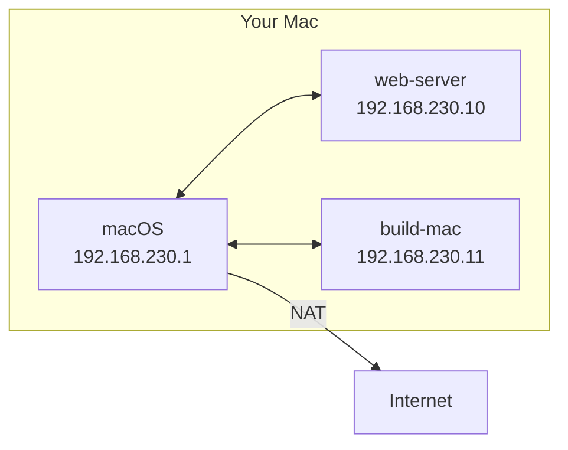

# Networking

Every machine is on one shared network that SwiftVM manages. Guests reach the
internet through your Mac, and your Mac and the guests reach each other
directly.



## Addresses

- Each machine has its own address, which stays the same every time it starts.
- SwiftVM picks an address range that doesn't collide with the networks your
  Mac is on. **Settings → Network** shows it.
- A machine created while others are running gets a temporary address. It
  takes its own once every machine has been stopped and one is started again.

Find a machine's address in the panel, with **Copy IP Address** in its menu,
or with `swiftvm ip <machine>`.

## The cable

Pull a machine's network cable with the **Network** switch in its toolbar,
**Connected** in its settings, or from the command line:

```bash
swiftvm unplug web-server
swiftvm plug web-server
```

## Port forwarding

A forwarded port makes a service in the guest reachable as `localhost` on your
Mac, for example `localhost:8080` for a web server on the guest's port 80. You
can always reach the guest at its own address without forwarding.

Add one under **Network** in the machine's toolbar, in its settings, or with:

```bash
swiftvm forward web-server 8080:80     # localhost:8080 is the guest's port 80
swiftvm forward web-server 5353 --udp  # the same port on both sides, UDP
swiftvm unforward web-server 8080
```

- Forwards can be added and removed while the machine runs.
- Only your Mac can connect, unless you turn on **Let other devices on the
  network connect** (`--allow-others`).
- If the port is in use on your Mac, SwiftVM keeps trying until it is free.
  `swiftvm info <machine>` shows each forward's status.

## Not yet

Bridged, host-only, and isolated networks, and more than one network card per
machine.
