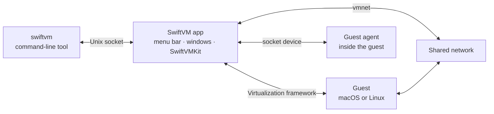

# Technical design

How SwiftVM is built.

The big ideas:

1. **Machines run inside the app.** Apple's Virtualization framework runs each
   guest in the app's own process. There is no helper, no kernel extension, and
   nothing runs as root.
2. **A machine is a folder.** Its settings, disk, firmware, and snapshots live
   in one `.swiftvm` package. Copies and snapshots are APFS clones of its
   files.
3. **The app owns the machines; the command line drives the app.** `swiftvm`
   is a thin client of the running app, so the panel and the terminal can
   never disagree.
4. **The guest agent needs no network.** It talks to the app over the
   machine's socket device, so the clock, shutdown, and clipboard work when
   the guest's network is down.
5. **The engine is separate from the interface.** Everything that isn't
   interface is in the `SwiftVMKit` package, behind a backend protocol that a
   second engine can implement.

## Read next

1. [Architecture](./architecture.md): programs, modules, and what happens when
   a machine starts.
2. [Decisions](./decisions.md): the key choices and what was turned down.
3. [Constraints](./constraints.md): supported platforms and hard-won lessons.
4. [Building](./building.md): building, signing, and the development copy.
5. [Releasing](./releasing.md): how a release is made and how updates reach
   people.
