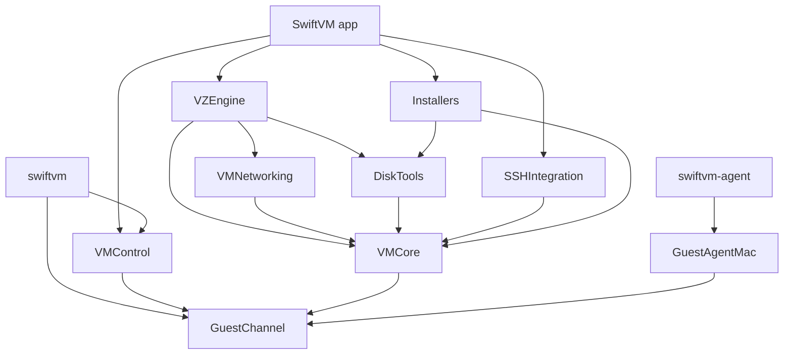
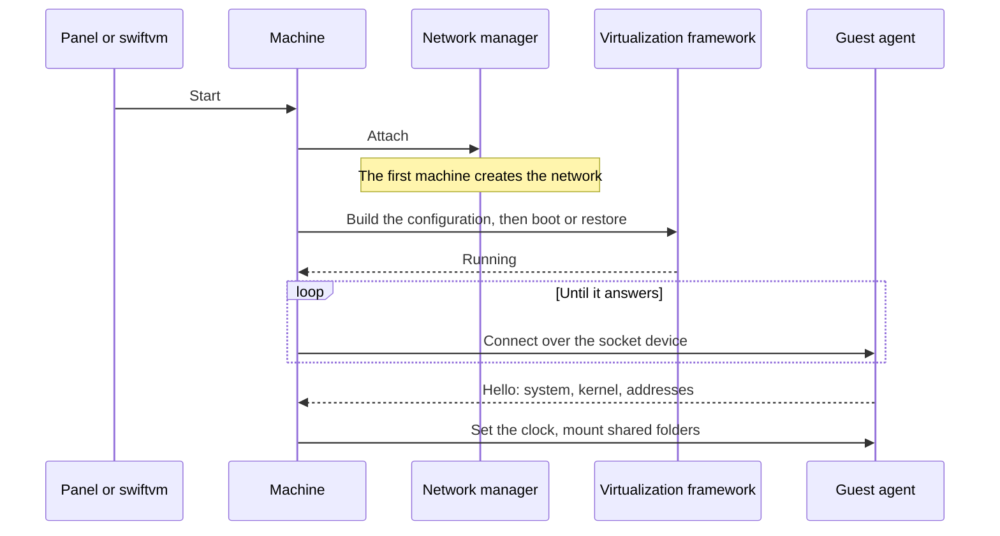
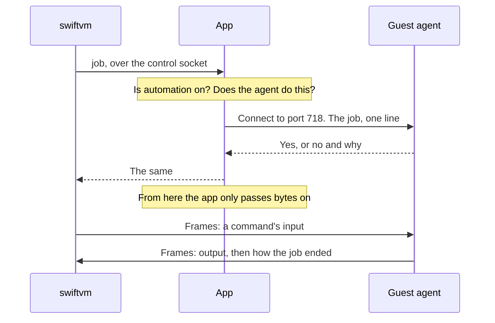
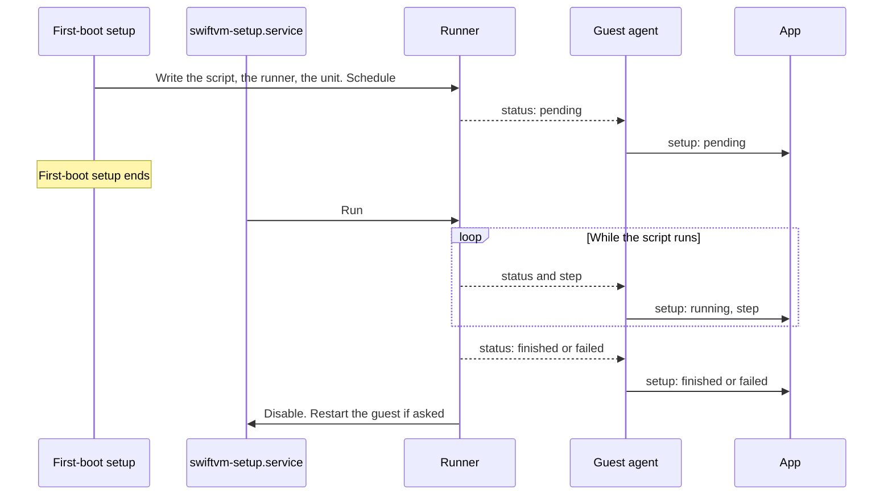

# Architecture

The programs, the modules, and how they work together.

## Programs

| Program | Where it runs | What it does |
| --- | --- | --- |
| SwiftVM | Your Mac | The app. Owns every machine and runs the guests |
| `swiftvm` | Your Mac | The command-line tool, inside the app at `Contents/Helpers`. Sends requests to the running app |
| `swiftvm-agent` | macOS guests | The guest agent for macOS. Built with the app and carried into guests by an installer |
| `swiftvm-agent.py` | Linux guests | The guest agent for Linux: one Python script and its systemd units |

Both agents also do [jobs](#jobs-in-the-guest) for `swiftvm`: commands, the
screen, the mouse, and the keyboard.

## Modules

The app is the package at the repository's root. Everything that isn't
interface is in `Packages/SwiftVMKit`.

| Module | Role |
| --- | --- |
| `App/` | The SwiftUI app: the menu bar panel, the windows, and the model behind them |
| `VMCore` | What a machine is: its configuration, its package on disk, the library, snapshots, the serial console, USB rules. Knows no engine |
| `VZEngine` | Runs machines on the Virtualization framework, and installs macOS |
| `VMNetworking` | The shared network, address reservations, and the port relay |
| `SSHIntegration` | SSH names, keys, and the generated SSH configuration |
| `DiskTools` | Creates, grows, and converts disk images, and builds small ISO images |
| `Installers` | The distribution catalog, setup scripts, downloads, first-boot setup for Linux, and the guest agent installers |
| `VMControl` | The messages between the app and `swiftvm`, and which copy of the app a program belongs to |
| `GuestChannel` | The messages between the app and a guest agent, and the jobs an agent does for `swiftvm` |
| `GuestAgentMac` | The guest agent for macOS |

`VMCore` defines a backend protocol, and `VZEngine` is its only
implementation today. A second engine for Windows guests would sit next to it.

## A machine on disk

A machine is a `.swiftvm` package in the library folder.

| File | What it holds |
| --- | --- |
| `config.json` | The machine's configuration. Newer fields decode with defaults, so older machines keep opening |
| `disk.img`, `disk.asif` | The disk: raw for Quick Create machines, ASIF for the rest |
| `efi-vars.fd` | Linux: UEFI variables |
| `aux.img`, `hardware-model.bin`, `machine-identifier.bin` | macOS: firmware state and the machine's identity |
| `seed.iso` | Linux Quick Create: the first-boot setup data, with the setup script if one was picked |
| `state.vzvmsave` | Saved memory, while suspended |
| `snapshots/` | One folder per snapshot |
| `logs/console.log` | Serial console output |

New machines are built in a staging folder and moved into the library once
they are complete, so a creation that is cut short leaves nothing behind.

## Starting a machine

## The control socket

- The app listens on a Unix socket, `control.sock`, in its data folder. Only
  the current user can connect.
- `swiftvm` sends one JSON request per line and waits for the answer, however
  long the operation takes.
- The console and socket-device commands turn the connection into a byte
  stream after the app agrees. So do the [jobs](#jobs-in-the-guest) that
  `swiftvm` has a guest's agent do.
- The tool finds its app by where it is: it follows its own path up to the app
  it is inside of, and uses that app's data folder.

## The guest channel

- Each machine has a virtio socket device. The agent listens on port 717 and
  the app connects, again whenever a guest comes up or resumes.
- Both sides send one JSON object per line and ignore what they don't know.
  The agent names what it can do in its hello, and the app asks for nothing
  else.
- Only root can listen below port 1024 in a guest, so the app knows who
  answers. The agent only accepts connections from the host.
- The macOS agent runs as two halves. A root daemon talks to the app and
  handles power, clock, and time zone. A second half in the login session
  owns the clipboard, the screen, the mouse, and the keyboard, and reaches
  the daemon over a Unix socket.
- The Linux agent also passes on how the machine's
  [setup script](#setup-scripts) is doing, unasked, whenever that changes.

## Jobs in the guest

`swiftvm exec`, `cp`, `screenshot`, and `ui` are jobs that a guest's agent
does. See [Automation](../features/automation.md).

- A job has a connection of its own, to a second port of the agent, 718. The
  line on port 717 stays what it was: short messages, one at a time. A job
  carries megabytes, lasts as long as a command runs, and many run at once.
- The app decides whether a job is given: the machine's switch has to be on,
  and the agent has to name the feature in its hello. It sends the job, reads
  the agent's answer, and from then on is a relay. `swiftvm` and the agent
  speak to each other in frames: a kind, a length, and that many bytes.
- Hanging up calls a job off. The agent ends the command it was running. An
  agent that doesn't hang up in turn is hung up on by the app, a little later.
- The agent ends a job by saying that it sends no more and waiting for the
  other side to hang up. See [Constraints](./constraints.md#networking).
- `swiftvm cp` is `exec` twice over: `tar` packs on one side and unpacks on
  the other. What a guest sends is unpacked in a folder of its own first.

| Job | Linux agent | macOS agent |
| --- | --- | --- |
| Command | A process of the account it runs as, with the environment of that user's desktop session if there is one | The agent's own program, started as `run-as`: it becomes the account, then the command. Inside the user's session if they are logged in |
| Screenshot | What the display shows, read from the kernel's mode setting | ScreenCaptureKit, in the session's half |
| Mouse and keyboard | Input devices of its own, made through `uinput` | Core Graphics events, in the session's half |
| Tree | AT-SPI, asked by the same script run as the user at the screen | The accessibility API, in the session's half |

In a macOS guest, the screen, mouse, and keyboard belong to whoever is logged
in. The root daemon takes the job, tells the session's half its name, and the
session's half connects for it on a second Unix socket. The daemon then passes
bytes on between the two connections.

## Networking

- All machines share one NAT network made with vmnet. It is created when the
  first machine starts and released when the last one stops.
- Each machine's address is reserved for its MAC address when the network is
  created.
- Forwarded ports are relayed by the app itself, so they can change while
  machines run.
- The app picks a private address range that the Mac isn't using, and moves to
  another if that one can't be created.

## Creating machines

- **Linux, Quick Create.** Download the cloud image and verify its checksum,
  convert it to a raw disk, and write a cloud-init seed image with the account,
  SSH key, host name, network setup, guest tools, and the setup script if one
  was picked.
- **Linux, installer disc.** Create an empty disk and attach the ISO as a USB
  drive.
- **macOS.** Install the restore image onto an empty disk, then start with an
  account for macOS to create by itself. SwiftVM then installs the SSH key and
  the guest tools over SSH.

## Setup scripts

A [setup script](../features/setup-scripts.md) is one file with a comment
header. One catalog is the only place scripts come from: the templates, which
are scripts inside the app, and the files in the user's folder,
`~/.config/swiftvm/setup-scripts`. A list fetched from elsewhere has one place
to join. The app and the command line show the same list, by kind.

A machine takes several scripts. They travel in its first-boot data, numbered
in the order they run, and the runner in the guest goes through them: it notes
each one that came to its end, so that a run that failed or was cut short
carries on with the one that wasn't through.

- The script travels in the seed image, next to a runner and a systemd unit.
  First-boot setup writes them down and schedules the unit, which runs once
  that setup is over.
- The runner writes everything the script prints to a log, keeps a note of the
  state and the step, and restarts the guest if the header asks. The agent
  reads the note and tells the app.
- The unit stays enabled until the script has finished or failed. A setup that
  is cut short carries on at the next start; one that keeps being cut short is
  given up on.
- A copy of a machine goes through first-boot setup again. The runner leaves a
  disk alone where a setup was scheduled before, so nothing is installed twice.

## Snapshots and copies

- A snapshot is a copy of the machine's disk, firmware, and saved memory, kept
  in the package. On APFS the copy is a clone and takes no time.
- A running machine is suspended, copied, and resumed.
- Going back copies the snapshot's files next to the machine's first, then
  swaps them in. If that is cut short, the machine never ends up with memory
  saved next to a disk it doesn't belong to.

## The app in the menu bar

- The app has no Dock icon by default. It enters the Dock while one of its
  windows is open and leaves once another app comes to the front.
- Messages that have no window to show in become a card at the top of the
  panel.
- Updates come through Sparkle. See [Releasing](./releasing.md).
