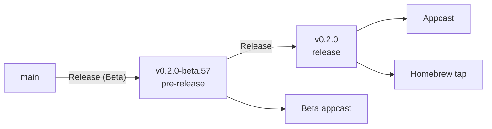

# Releasing

How a release is made, and how updates reach people.



## Channels

| Channel | Version | Who gets it |
| --- | --- | --- |
| Beta | `X.Y.Z-beta.N` | People who installed a beta build |
| Stable | `X.Y.Z` | Everyone else, and Homebrew |

- `BETA_VERSION` holds the version that betas count toward. `N` is the number
  of commits, which is also the build number.
- A stable release is always a beta that was promoted: the beta's tag is built
  again under the stable version.

## Making a release

Both workflows are started by hand, under **Actions** on GitHub.

1. Run **Release (Beta)** with `main` selected. It builds the selected ref as
   the next beta and publishes it as a pre-release. Try that build.
2. Run **Release** with the beta's tag, the stable version, and the version
   the next betas should count toward. It publishes the release, updates the
   Homebrew tap, puts the website online as it is at the release's tag, and
   writes the new `BETA_VERSION` to `main`.

With **draft** enabled, **Release** creates a draft and still bumps
`BETA_VERSION`, but skips Homebrew and the website. After publishing the
draft, run **Update Homebrew Tap** and **Deploy Website** for its release tag.

The website changes with a stable release and not with a push to `main` or a
beta, so its documentation is that of the latest stable version. To change it
in between, run **Deploy Website**.

## Workflows

| Workflow | What it does |
| --- | --- |
| Checks | On pull requests: builds the app and runs the tests |
| Release (Beta) | Builds the selected ref as a beta, publishes a pre-release, and adds it to the beta appcast |
| Release | Promotes a beta to stable, publishes the release with its appcast, deploys the website, and bumps `BETA_VERSION` |
| Update Homebrew Tap | Writes the cask to `swiftvm-app/homebrew-tap`. Runs after a release, or by hand |
| Republish Beta Appcast | Puts a beta back into the beta appcast |
| Build Release | The build that both releases share |
| Deploy Website | Builds [the website](../../website/README.md) and puts it online. Runs after a release, or by hand |

The workflows that build the app use the `xcode-27` runner with the macOS 27
SDK.

## What a release build does

1. `scripts/build-release.sh` builds the app, including QEMU for Windows guests,
   sets its version and update feed, and signs it with the Developer ID
   certificate and the USB provisioning profile. It then creates the disk image.
2. The workflow has Apple notarize the disk image and staples the ticket to
   it.
3. `scripts/generate-appcast.sh` signs the disk image with the update key and
   adds it to the appcast.

To try the build on your Mac:

```bash
scripts/build-release.sh --version 0.2.0-beta.1    # into build/release
```

Local builds use the available [signing identity](building.md#signing) and
are not notarized by this script. Automatic updates require both
`--sparkle-public-key` and `--sparkle-feed-url`; the workflows supply them.

## Updates

The app updates itself with [Sparkle](https://sparkle-project.org).

| Channel | Appcast |
| --- | --- |
| Stable | `appcast.xml` of the latest release |
| Beta | `appcast-beta.xml` of the `beta-channel` pre-release. Don't delete that release |

- Published releases carry the appcast address and the public half of the
  update key. Builds without these settings don't update.
- The app only installs updates that are signed with the update key. If the
  key is lost, the apps that are out there can't be updated any more.
- Updates found automatically are announced in the menu bar panel, including
  those being downloaded automatically. **Update…** opens Sparkle's dialog
  when asked; scheduled checks don't open it on their own, even just after
  launch.
- Installing an update quits the app the usual way, with the usual question
  about running machines.

## Secrets

The workflows read these from the repository's secrets.

| Secret | What it is |
| --- | --- |
| `DEVELOPER_ID_APPLICATION_CERTIFICATE` | The Developer ID Application certificate with its private key, as a `.p12` file in Base64 |
| `DEVELOPER_ID_APPLICATION_PASSWORD` | The password of that `.p12` file |
| `KEYCHAIN_PASSWORD` | Any password. It locks the temporary keychain on the runner |
| `DEVELOPER_ID_PROVISIONING_PROFILE` | The Developer ID provisioning profile for `com.swiftvm.app` with **Claim USB Accessory**, in Base64 |
| `APPLE_ID` | The Apple ID that notarizes |
| `APPLE_APP_SPECIFIC_PASSWORD` | An app-specific password of that Apple ID |
| `APPLE_TEAM_ID` | The team's ID |
| `SPARKLE_PRIVATE_KEY` | The update key, from `swift scripts/generate-sparkle-key.swift` |
| `HOMEBREW_TAP_TOKEN` | A token that can push to `swiftvm-app/homebrew-tap` |
| `GH_RELEASE_PAT` | Optional. A token that can push to `main`, if `main` is protected |
| `CLOUDFLARE_API_TOKEN` | For the website: a Cloudflare API token from the **Edit Cloudflare Workers** template |
